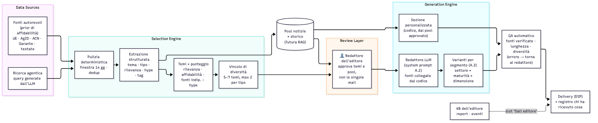
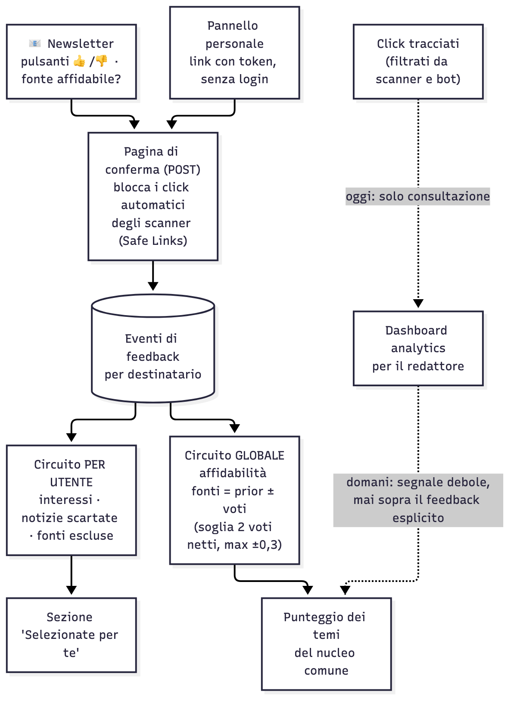

# AI Brief

Sistema white-label per newsletter sull'intelligenza artificiale, pensato per centri di ricerca, associazioni e media che scrivono per AI decision maker (AI Head, CDO, CIO) di imprese e pubblica amministrazione.

Una pipeline LLM raccoglie e seleziona le notizie delle ultime due settimane, un redattore umano approva, e ogni lettore riceve una versione adattata al suo profilo. Nome della newsletter, editore e sezione dei contenuti propri si configurano con variabili d'ambiente.

**Istanza demo:** https://ai-brief-demo-one.vercel.app. La modalità Replay è aperta a tutti; la modalità Live richiede un codice di accesso.



## Cosa fa

1. **Cerca** le notizie IA degli ultimi 14 giorni. Il modello decide le ricerche, il codice le esegue.
2. **Valuta** ogni articolo: rilevanza per il lettore, livello di hype, tema.
3. **Seleziona** 5–7 temi con un punteggio trasparente e un vincolo di varietà.
4. **Si ferma per il redattore**, che approva temi e notizie.
5. **Scrive** la newsletter con fatto e commento separati. Le fonti le collega il codice, non il modello.
6. **Adatta** ordine e commento a ogni profilo (settore × maturità IA × dimensione). I fatti restano uguali per tutti.
7. **Impara dai lettori**: voti su notizie e fonti, raccolti con una pagina di conferma (gli antivirus aziendali aprono tutti i link delle mail).

La spiegazione file per file è in [`docs/mappa-codice.html`](docs/mappa-codice.html) (scaricala e aprila nel browser).



## Configurazione del marchio

| Variabile | Esempio | Dove compare |
|---|---|---|
| `BRAND_NAME` | `AI Brief` | Nome della newsletter, in pagina e nei prompt |
| `PUBLISHER_NAME` | `Editore Demo` | Intestazione della mail e prompt |
| `PUBLISHER_DESC` | `Editore Demo, centro di ricerca sull'innovazione digitale` | Contesto dato al redattore LLM |
| `PUBLISHER_SECTION` | `Dall'editore` | Titolo dello slot con report ed eventi dell'editore |

## Scelte tecniche

- **Pipeline, non agente.** Cinque chiamate al modello con un ruolo fisso, messe in fila dal codice: costi prevedibili (9 chiamate per run) e ogni passaggio si testa da solo.
- **Output strutturato robusto.** Ogni risposta viene validata con Pydantic. Se il JSON non è valido, l'errore torna al modello per un secondo tentativo, poi si passa a un altro modello.
- **Client compatibile OpenAI.** Lo stesso codice funziona con OpenRouter (modelli gratuiti) e con un modello self-hosted (Gemma 4 31B su vLLM).
- **Un endpoint per passaggio**, ognuno con una scadenza interna, per restare nel limite di durata delle funzioni serverless.
- **Quote per codice di accesso**, con un tetto globale, per proteggere la chiave del gateway nella modalità live.

## Struttura

| Percorso | Contenuto |
|---|---|
| `core/prompts.py` | I cinque prompt: pianificazione, valutazione, raggruppamento, redazione, personalizzazione |
| `core/models.py` | Schemi Pydantic delle risposte |
| `core/llm.py` | Client del modello: validazione, correzione, fallback, scadenza |
| `core/pipeline.py` | Passaggi, punteggio, selezione, controlli QA, feedback |
| `core/sources.py` | Ricerca su Google News RSS e affidabilità delle fonti |
| `api/index.py` | API FastAPI |
| `public/` | Interfaccia (4 passi) e pannello personale del lettore |
| `scripts/make_replay.py` | Genera il run salvato mostrato in modalità Replay |
| `tests/fake_run.py` | Prova il flusso completo senza modello |
| `docs/` | Diagrammi (sorgenti Mermaid e PNG) e mappa del codice |

## Avvio in locale

```bash
cp .env.example .env   # LLM_API_KEY (OpenRouter), ACCESS_CODES, marchio
pip install -r requirements.txt uvicorn
python scripts/make_replay.py          # genera public/replay.json
uvicorn api.index:app --port 8765      # http://localhost:8765
```

Senza chiave: `python tests/fake_run.py`.

## Deploy

Vercel: frontend statico e funzione Python FastAPI. Oltre alle variabili del `.env`, collega Upstash Redis dal Marketplace (`KV_REST_API_URL`, `KV_REST_API_TOKEN`) per salvare run, feedback e registro invii.

## Demo e produzione a confronto

| | Demo | Produzione |
|---|---|---|
| Ricerca | Google News RSS (uso non commerciale) | Feed diretti e API di news con licenza |
| Testo degli articoli | Titolo ed estratto | Testo completo |
| Modelli | Gratuiti | Modello piccolo per le valutazioni, modello forte per la scrittura |
| Invio | Simulato, con registro | Servizio email, click filtrati dagli scanner |
| Lettori | 3 profili di esempio | Iscrizione, consenso GDPR, link personali ruotabili |

Sviluppato con l'aiuto di Claude (Anthropic) come assistente di programmazione.
